# Narasi → scene → prompt produksi → render

Audit 4 November menemukan masalah urutan: satu panggilan model menulis narasi sekaligus visual/timing, Storyboard terutama merupakan salinan Scene Plan, dan fallback naskah lokal membuang teks setelah 12 bagian. Kualitas encoder/60 fps tidak menyelesaikan masalah perencanaan tersebut.

## Referensi yang dipelajari

- [Adobe — Shooting scripts](https://www.adobe.com/creativecloud/video/discover/shooting-script.html): narasi/screenplay menjadi dasar storyboard, shot list dan petunjuk produksi terperinci. Prinsip yang dipakai: pisahkan cerita dari keputusan pengambilan gambar, nomor scene dan revisi yang jelas.
- [Google Cloud — Veo prompt guide](https://cloud.google.com/blog/products/ai-machine-learning/ultimate-prompting-guide-for-veo-3-1): struktur instruksi visual memisahkan sinematografi, subjek, aksi, konteks dan suasana. Dipakai sebagai susunan prompt produksi, bukan klaim adapter native berubah menjadi Veo atau menjalankan semua kalimat bebas.
- [Remotion — template prompt-to-video resmi](https://github.com/remotion-dev/remotion/blob/main/packages/template-prompt-to-video/README.md): tahap menghasilkan script, aset/suara bertimestamp, lalu timeline yang dirender. Prinsip yang dipakai: renderer mengonsumsi rencana/timeline konkret yang telah dibentuk upstream. Tidak menyalin kode, template atau aset referensi.

Ini sintesis yang disesuaikan dengan aplikasi ini; urutan detail dapat berbeda antarjenis produksi.

## Alur yang diterapkan

```mermaid
flowchart LR
 B[Brief: topik + arahan produksi] --> R[Konteks / riset sesuai mode]
 R --> N[Narasi utuh]
 N --> S[Breakdown scene + visual + timing]
 S --> A[Review narasi + Scene Plan]
 A --> P[Storyboard + prompt produksi per shot]
 P --> G[Review Storyboard]
 G --> U[Validasi audio]
 U --> V[Render native 30/60 fps]
 V --> Q[Review hasil + bundle]
```

1. **Input dibedakan.** Topik dan arahan produksi (tujuan/audiens/gaya) dipisahkan dari naskah yang dibacakan. `creativeBrief` maksimal 4.000 karakter; bukan narasi suara. Naskah kosong berarti model menyusun narasi; naskah yang sudah diberikan dipertahankan. Timecode eksplisit tetap menjadi sumber waktu/teks.
2. **Narasi lebih dahulu.** Untuk input judul, model terpilih diminta menulis JSON narasi utuh terlebih dahulu, tanpa storyboard/kode. Draft tersimpan di checkpoint. Saat breakdown gagal dan dilanjutkan, draft digunakan kembali agar cerita tidak berubah tanpa sengaja.
3. **Scene planner menerima narasi terkunci.** Model boleh membagi narasi dan menentukan visual, judul, kamera, transisi serta timing. Teks seluruh scene harus sama dengan draft (perbedaan whitespace diizinkan); angka, negasi, urutan, pengulangan dan ekor naskah diperiksa sebagai teks utuh. Scene yang dibuat planner harus mencakup target durasi tanpa gap. Ini pemeriksaan kesetiaan teks, bukan fact-check.
4. **Mode lokal tetap lokal.** `provided` tidak memanggil model; fallback mengelompokkan semua bagian ke maksimal 12 scene tanpa membuang sisanya. Arahan visual perlu diisi/diperiksa pengguna. Pilih mode planner bila ingin AI merancang visual dari naskah yang sudah ada; narasi tetap dipertahankan.
5. **Dua approval dipertahankan.** Review pertama menampilkan narasi utuh bersama Scene Plan. Setelah disetujui, `video_preproduction.py` menyusun prompt per shot dari subjek/aksi/komposisi/lapisan/kamera/lighting/transisi/kontinuitas/suara serta data native yang dikenali. Storyboard menampilkan prompt dan keterbatasan grammar untuk ditinjau sebelum approval kedua.
6. **Paket produksi terikat revisi.** Paket memuat digest plan, adapter, rasio, fps, teks/narasi dan input native. Job baru bertanda `pipelineVersion=2`; API approval dan worker sama-sama menolak paket hilang/stale sebelum audio/render. Edit plan membatalkan paket, review dan approval; narasi review ikut diperbarui. Plan lama tetap dapat digunakan melalui review ulang, tanpa migrasi/render otomatis.
7. **Render memakai data terstruktur.** Prompt teks merupakan arahan produksi yang bisa ditinjau. Engine lokal memakai Scene Plan/manifest yang diikat paket, bukan mengeksekusi prompt sebagai kode. Audio dibuat/divalidasi sesudah approval dan sebelum encode visual; durasi suara berlebih tetap ditolak. Tidak mengklaim forced alignment atau penerapan seluruh prosa.
8. **Handoff dapat diaudit.** `narration.json` dan `production-prompts.json` ditulis bersama plan, subtitle, audio manifest dan output. Keduanya tersedia lewat allowlist unduhan dan bundle yang sama, tetap dengan redaksi/path guard.

## Validasi dan batas

Tes baru mencakup urutan dua panggilan model, teks narasi yang masuk scene planner, angka/negasi/ekor naskah, 30 kalimat yang dikelompokkan tanpa hilang, checkpoint draft saat model gagal, brief yang tidak dibacakan, durasi/gap, paket stale/missing, invalidasi setelah edit dan ekspor bundle. Mock model dipakai agar tes tidak bergantung provider daring.

Uji penerimaan tambahan melewati judul → dua respons model yang dimock → review Scene Plan → prompt/Storyboard → review kedua → audio musik lokal → MP4 Remotion nyata 320×568/60 fps. Review mengonfirmasi fps cocok, kedua approval tercatat, narasi tetap utuh, paket dua shot serta kedua artefak masuk bundle. Ini bukti alur kerja lokal; bukan verifikasi kualitas model/TTS daring atau laptop Windows. Tidak memutar media atau merender ulang proyek lama.

Validasi akhir: 171 tes dashboard lulus; 8 tes produksi/varian terkait juga lulus setelah gate paket diberlakukan pada varian rasio baru. Smoke HTTP dan UI (narasi utuh, brief terpisah, 19 prompt tampil, tanpa error JavaScript) lulus. Bukti penerimaan: `docs/benchmarks/preproduction-20261104.json`. Workflow Windows menambah suite preproduksi, namun run Windows perubahan ini belum diverifikasi.
